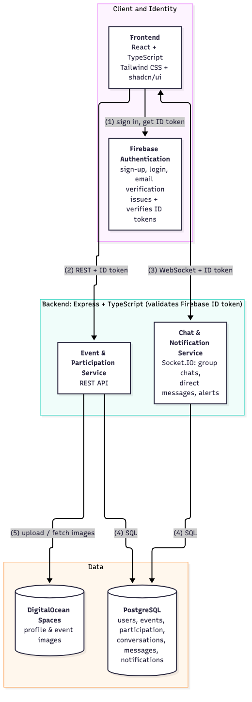

# Event Buddy Finder

Event Buddy Finder helps people discover local events, express interest or mark themselves as going, and meet other attendees through event chat.

## Architecture

The application uses a React and TypeScript frontend with separate Express and TypeScript services for authentication, profiles, events, chat and notifications, and images. Firebase Authentication manages accounts and email verification. The services use PostgreSQL for application records and DigitalOcean Spaces for private image objects; image object keys are stored with the related profile or event, and the image API returns expiring signed URLs for display.



See the [project proposal](docs/event-buddy-finder-proposal.md), [database overview](docs/database-overview.md), and [database setup](database/README.md) for design details.

## Run locally

For a preloaded local demo, start Docker and run `./install.sh`. See the [local setup guide](docs/deployment/README.md) for the URL and demo accounts. For manual service setup, see the [web app setup guide](apps/web/README.md).

Requirements for manual setup: Node.js 20.19 or newer, pnpm 11, PostgreSQL, and a Firebase project or Auth Emulator. The web guide covers environment variables, migrations, demo data, and service startup. Database schema and optional seeded event data are documented in the [database guide](database/README.md).

At a high level:

```sh
pnpm install
# Configure service and frontend environment variables as described in the setup guide.
# Apply database/migrations/001–004 and optionally load database/seeds/001–002.
pnpm dev
```

The frontend is available at `http://localhost:5173`. Use `pnpm build`, `pnpm typecheck`, `pnpm test:unit`, and `pnpm test:e2e` to build and verify the workspace. GitHub Actions runs build/typecheck, PostgreSQL-backed unit/service tests, and the Chromium end-to-end flow on pull requests and pushes to `main`.

## User guide

Browse public events without signing in. Register and verify an email address to complete a profile and post events. Signed-in users can mark an event as interested or going; interested and going users can access its group chat. Event creators can edit or cancel their events. The chat and notification services store messages and alerts in PostgreSQL and deliver live updates through Socket.IO. Profile and event photos are uploaded through the image API and served using temporary signed URLs.

For local demo accounts, mock events, and image setup, follow the [frontend guide](apps/web/README.md) and [image API guide](services/image-api/README.md#development-demo-images). Demo records are fictional and are not Firebase accounts. The optional live Firebase and Spaces checks are described in [live cloud testing](docs/live-cloud-testing.md); they require a dedicated non-production project, bucket, and GitHub environment secrets.

## API reference

- [Authentication API](services/auth-api/README.md)
- [User profiles API](services/user-api/README.md)
- [Events and participation API](services/events-api/README.md)
- [Chat and notifications API](services/chat-api/README.md)
- [Images API](services/image-api/README.md)

## Contributing

Create a focused branch from the latest `main`. Keep frontend code in `apps/web`, service code in `services`, shared request and response types in `packages/contracts`, and database changes in `database`. Never commit credentials. Use the API and service READMEs above when changing an endpoint, and run the checks listed under [Run locally](#run-locally).

## Video demo

The team-recorded, narrated submission demo is still to be added. It should show event discovery, a verified sign-in, event participation, an image upload, chat, and an event notification.
