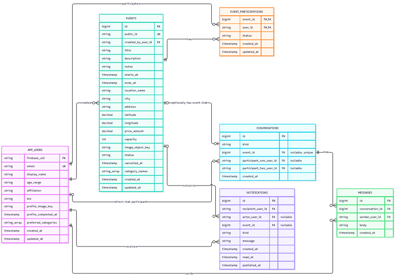
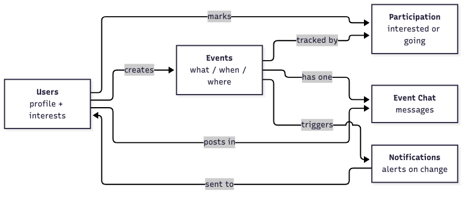

# Consolidated PostgreSQL database

After migrations `001`–`004`, the application stores data in **six PostgreSQL tables**. Migration `004_consolidate_schema.sql` consolidates the original 13-table design while preserving the supported users, events, attendance, chats, messages, and notifications. PostgreSQL stores application records and image object keys; Firebase Authentication stores login identities, and DigitalOcean Spaces stores image bytes.

## Diagrams

The ER diagram shows all six tables, their key fields, and relationships. The overview diagram summarizes the main application concepts and how they connect.

## Tables and relationships

| Table | Primary key | Purpose and relationships |
| --- | --- | --- |
| `app_users` | `firebase_uid` | Profile for a Firebase identity. Referenced by event creators, participation rows, chat participants, message senders, and notifications. |
| `events` | `id` | Event listing owned by one `app_users` row. Has participation rows, at most one event conversation, and notification rows. |
| `event_participations` | (`event_id`, `user_id`) | Connects one user to one event with an attendance status. Both columns are foreign keys. |
| `conversations` | `id` | One event chat linked to an event, or a direct chat with two user IDs. |
| `messages` | `id` | Message linked to a conversation and its sending user. |
| `notifications` | `id` | Persistent inbox notification linked to its recipient and optionally its actor and event. Also tracks real-time publication and read state. |

## Schema details

`PK` means primary key, `FK` means foreign key, and `UNIQUE` means a unique constraint or index. The SQL migrations define the authoritative checks, partial indexes, defaults, and delete behavior; Prisma models in `packages/database/prisma/schema.prisma` provide typed access to these same tables.

### `app_users`

| Column | PostgreSQL type | Key / use |
| --- | --- | --- |
| `firebase_uid` | `TEXT` | PK; Firebase Authentication UID |
| `email` | `TEXT` | Required, UNIQUE |
| `display_name` | `TEXT` | Required public name |
| `age_range` | `TEXT` | Optional, constrained to the supported age bands |
| `affiliation`, `bio` | `TEXT` | Optional profile details |
| `profile_image_key` | `TEXT` | Optional DigitalOcean Spaces object key |
| `profile_completed_at` | `TIMESTAMPTZ` | Set when profile setup is complete |
| `preferred_categories` | `TEXT[]` | Fixed category names; GIN-indexed |
| `created_at`, `updated_at` | `TIMESTAMPTZ` | Record timestamps |

### `events`

| Column | PostgreSQL type | Key / use |
| --- | --- | --- |
| `id` | `BIGINT` identity | PK |
| `public_id` | `TEXT` | Optional UNIQUE URL-friendly ID |
| `created_by_user_id` | `TEXT` | Required FK → `app_users.firebase_uid` |
| `title`, `description` | `TEXT` | Required event content |
| `notes` | `TEXT` | Optional attendee instructions |
| `starts_at`, `ends_at` | `TIMESTAMPTZ` | Required start and optional end; end must follow start |
| `location_name`, `city` | `TEXT` | Venue name and city |
| `address` | `TEXT` | Optional meeting address |
| `latitude`, `longitude` | `NUMERIC(9,6)` | Optional map coordinates, range-checked |
| `price_amount` | `NUMERIC(10,2)` | Optional non-negative price |
| `capacity` | `INTEGER` | Optional positive capacity |
| `image_object_key` | `TEXT` | Optional Spaces object key; image bytes stay in Spaces |
| `category_names` | `TEXT[]` | Fixed category names; GIN-indexed |
| `status`, `cancelled_at` | `TEXT`, `TIMESTAMPTZ` | `scheduled` or `cancelled`; cancellation timestamp must agree with status |
| `created_at`, `updated_at` | `TIMESTAMPTZ` | Record timestamps |

### `event_participations`

| Column | PostgreSQL type | Key / use |
| --- | --- | --- |
| `event_id` | `BIGINT` | Part of composite PK; FK → `events.id` |
| `user_id` | `TEXT` | Part of composite PK; FK → `app_users.firebase_uid` |
| `status` | `TEXT` | Attendance state, constrained by SQL |
| `created_at`, `updated_at` | `TIMESTAMPTZ` | RSVP timestamps |

The composite key allows one current RSVP per user/event. The database check retains statuses introduced by migration 003 (`interested`, `pending_approval`, `going`, `declined`, `withdrawn`) for migration compatibility. The current UI/API flow uses `interested`, `going`, and `withdrawn`; organizer approval is not implemented.

### `conversations`

| Column | PostgreSQL type | Key / use |
| --- | --- | --- |
| `id` | `BIGINT` identity | PK |
| `kind` | `TEXT` | `event` or `direct`, shape-checked |
| `event_id` | `BIGINT` | Nullable FK → `events.id`; at most one event chat per event |
| `participant_one_user_id`, `participant_two_user_id` | `TEXT` | Nullable FKs → `app_users.firebase_uid`; used for direct chats, ordered and distinct |
| `created_at` | `TIMESTAMPTZ` | Creation timestamp |

For event chats, membership is derived from the event creator and eligible RSVP. Direct conversations store exactly two users in canonical order, with a unique index preventing a duplicate pair.

### `messages`

| Column | PostgreSQL type | Key / use |
| --- | --- | --- |
| `id` | `BIGINT` identity | PK |
| `conversation_id` | `BIGINT` | Required FK → `conversations.id` |
| `sender_user_id` | `TEXT` | Required FK → `app_users.firebase_uid` |
| `body` | `TEXT` | Required, non-empty message text |
| `created_at` | `TIMESTAMPTZ` | Message timestamp |

A composite index on conversation, timestamp, and message ID supports ordered cursor pagination. Access checks happen in the chat service before history is read or a message is sent.

### `notifications`

| Column | PostgreSQL type | Key / use |
| --- | --- | --- |
| `id` | `BIGINT` identity | PK |
| `recipient_user_id` | `TEXT` | Required FK → recipient in `app_users` |
| `actor_user_id` | `TEXT` | Optional FK → actor in `app_users` |
| `event_id` | `BIGINT` | Optional FK → `events.id` |
| `kind`, `message` | `TEXT` | Notification type and display text |
| `created_at`, `read_at` | `TIMESTAMPTZ` | Creation and inbox read state |
| `published_at` | `TIMESTAMPTZ` | Socket.IO delivery-worker state; `NULL` means pending publication |

## What consolidation changed

The earlier design had 13 tables. Migration 004 moves fixed user/event category joins into the `preferred_categories` and `category_names` arrays; replaces the direct-chat membership table with two participant columns; and moves notification publication state onto each notification row. Groups and group memberships are removed because group-created events are outside the initial scope. The migration checks for unsupported group data, malformed direct chats, duplicate direct-chat pairs, and unknown categories, then rolls back instead of silently discarding those records.

The category list is a shared TypeScript constant in `packages/contracts`; PostgreSQL check constraints reject names outside that list. This keeps category filtering simple for a fixed catalog. If categories become user-managed, a normalized category table and join tables would be more appropriate.

## How the application accesses the data

- **Explore:** the events API filters and paginates `events` by city, date, status, and category array; it joins the event creator and aggregates participation counts.
- **Profile/history:** the user API reads `app_users` and joins `event_participations` to `events` for hosted, interested, and past-event views.
- **RSVP and chat access:** a unique participation row is inserted or updated. The chat service checks host/RSVP eligibility before loading messages or accepting Socket.IO messages.
- **Inbox and live alerts:** an event update/cancellation writes notification rows transactionally. The chat notification worker reads pending rows (`published_at IS NULL`), emits them to active users, and updates publication state. The inbox remains available after reconnecting.
- **Images:** the image API uploads bytes to Spaces and stores only an object key in `app_users.profile_image_key` or `events.image_object_key`. Reads return a temporary signed URL; that URL is not stored as a permanent database value.

Migration setup, seed commands, and rollout cautions are in [database/README.md](../database/README.md). The migration rationale and tradeoffs are in [database-consolidation.md](database-consolidation.md).
