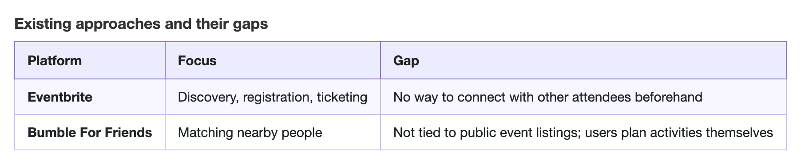
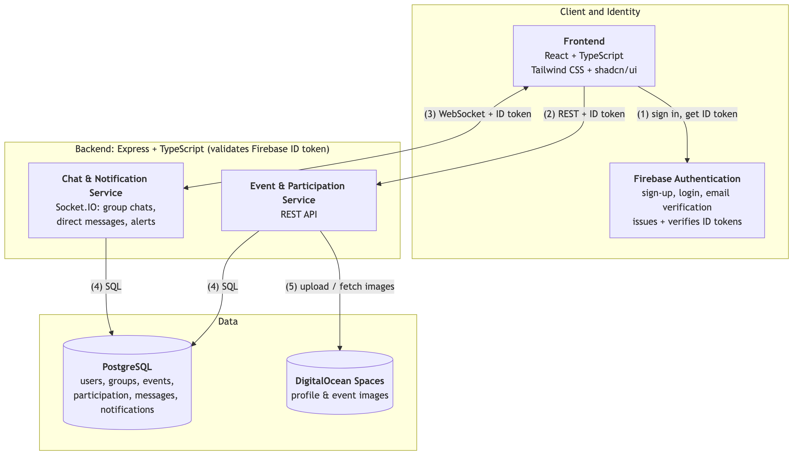
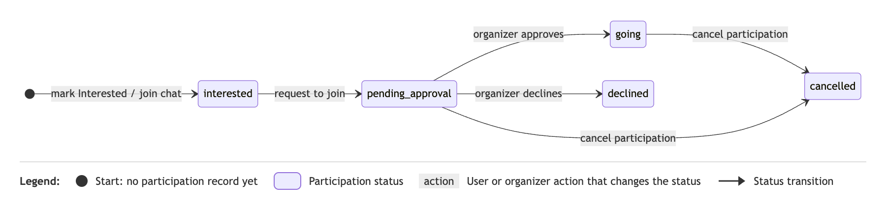
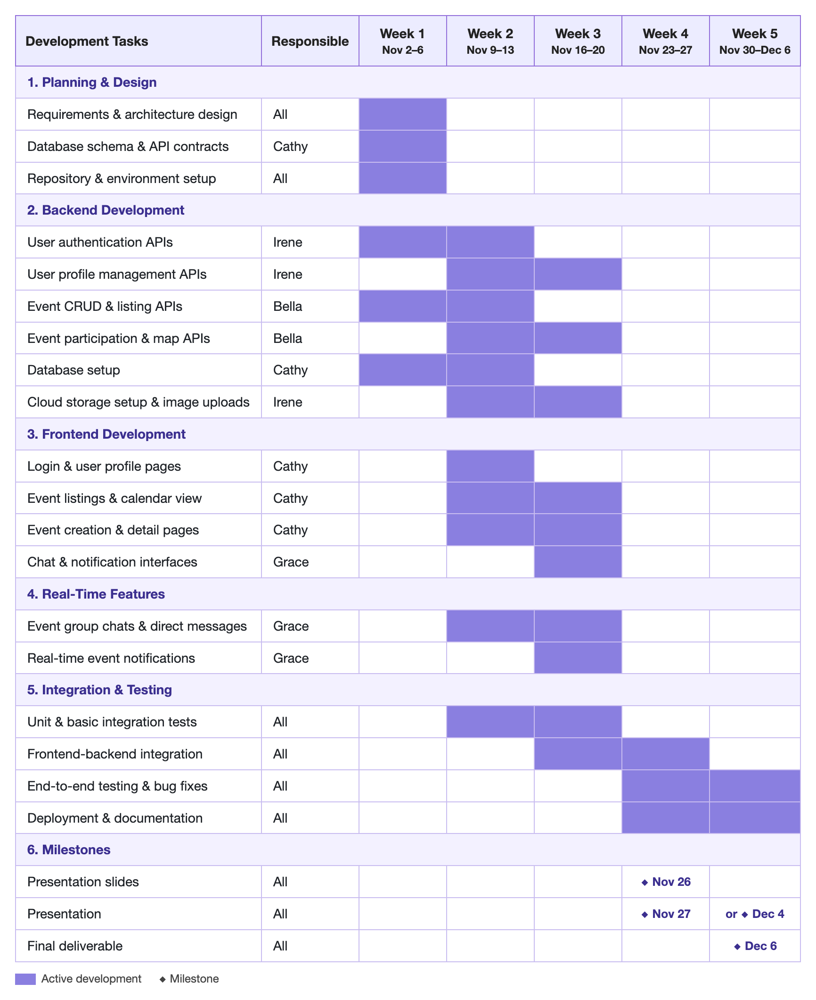

# Event Buddy Finder: Project Proposal

**Team:** Irene Li, Bella Huang, Grace Li, Cathy Chen

## Project Introduction

Event Buddy Finder is a social event-discovery platform for people across the Greater Toronto Area who want to explore local events and connect with others who share their interests. Individuals can browse a shared calendar of events grouped by category, location, attendance, and other details. Users can track events they are interested in, join event-specific group chats, and directly message people with similar interests. Registered groups can publish and update event listings. By combining event discovery with social interaction, Event Buddy Finder helps users make informed plans and find companions before attending an event.

## 1. Motivation

### 1.1 Problem

Many people who want to explore local events may not want to attend alone, may have friends who do not share the same interests, or may feel uncertain about trying an unfamiliar activity. Interest in an event usually forms at the moment of discovery, yet there is no direct way at that moment to find others who plan to attend.

### 1.2 Target Users

- **Attendees:** Greater Toronto Area residents who want to try local events but prefer not to attend alone.
- **Organizers:** Individuals and registered groups who post and manage event listings.

### 1.3 Limitations of Existing Approaches

Existing applications often focus mainly on either finding events or meeting people. Neither Eventbrite nor Bumble For Friends (Figure 1) helps users find companions while browsing public event listings.

*Figure 1: Comparison of Existing Approaches*

### 1.4 Why It Is Worth Solving

Event Buddy Finder addresses this gap by bringing event discovery, communication, and companion finding into one centralized platform, where users can join an event's group chat or directly message others interested in attending, creating a clearer path from interest to conversation, planning, and attendance while reducing the social pressure of joining an unfamiliar activity alone. Organizers also gain a direct way to answer questions, share updates, and understand attendee interests, helping them build stronger communities around recurring activities.

## 2. Objectives, Architecture, and Key Features

### 2.1 Objectives

The objective of this project is to develop a web application that combines event discovery with social interaction, allowing users to post and find local events, find companions, and coordinate participation. The project will focus on delivering a functional end-to-end workflow, from browsing events to connecting with other attendees.

### 2.2 Project Scope

- User authentication and profiles
- Event discovery with calendar, search, and filters
- Event management
- Event participation with organizer approval
- Real-time group chats and direct messaging
- Real-time event notifications

Waitlists, personalized event recommendations, automated companion matching, and payment processing will remain outside the initial scope.

### 2.3 Feasibility

The project is feasible within the course timeline because its functionality can be divided into independent development tasks, so that our four team members can work on frontend interfaces, event management, database integration, and communication features in parallel within five weeks. By leveraging established frameworks and services, we can reduce implementation complexity and focus on the core user workflows.

### 2.4 Architecture and Technology Stack

Event Buddy Finder will use the course's **Option B (separate frontend and backend)** architecture: a React and TypeScript frontend that communicates through a RESTful API with a separate Express and TypeScript backend, whose API endpoints will be documented. The backend has two services: one for events and attendance, and another for chats and notifications.

*Figure 2: System Architecture*

**How the pieces interact:**

1. **Sign in:** The frontend signs users in through Firebase Authentication and receives an ID token; browsing public events requires no sign-in.
2. **REST:** Protected requests carry the token to the event and participation service, which validates it before acting.
3. **Socket.IO:** Group chats, direct messages, and event alerts use a token-authenticated connection to the chat and notification service.
4. **Database:** Both services read and write the shared PostgreSQL database.
5. **Files:** The event service stores images in DigitalOcean Spaces.

#### Frontend

- **Stack:** React and TypeScript, styled with Tailwind CSS and shadcn/ui.
- **Interface:** A responsive calendar and event list with date, category, and location filters. Event pages show details, a static location map, an "Interested" option, a "Request to Join" action, and event chat. The "Going" status appears after organizer approval.

#### Backend Services

- **Services:** Both services will use a shared PostgreSQL deployment to maintain consistency across related records. This simplifies cross-service data access but couples the services through a shared schema.
- **Statuses:** Events will have a `scheduled` or `cancelled` status. A separate user–event participation record will track `interested`, `pending_approval`, `going`, `declined`, or `cancelled`.

*Figure 3: Event Participation Status Lifecycle*

#### Database and File Storage

- **PostgreSQL:** The database stores users and profiles, groups, group memberships, events, event participation, chat messages, and notifications. Each event records its creator and, when posted on behalf of a group, the organizing group; messages and notifications link back to the relevant users and events.
- **Cloud storage:** The backend uploads profile pictures and event images to a DigitalOcean Spaces bucket and saves each object key or URL in the related PostgreSQL record. Spaces is the object-storage service used as an example in the course and has an S3-compatible API.

#### Design Rationale: Alternatives, Tradeoffs, Risks, and Assumptions

We chose a separate React frontend and Express backend over Next.js to keep interface and API responsibilities distinct and support parallel development, at the cost of more API coordination. PostgreSQL was selected over SQLite because our linked records benefit from relational constraints and transactions. Firebase Authentication was chosen over Better Auth because our team has more experience with it, at the cost of depending on an external provider. Socket.IO was chosen because it is an industry-standard library with extensive documentation.

Security is a risk because Firebase verifies identity, but permissions remain the backend's responsibility. We assume course-prototype scale, GTA users on web browsers, and email-verified organizers.

### 2.5 Basic Features

**User Profile Management:** Upon registration, users can create profiles with a picture, name, and preferred event categories. These preferences help personalize the event discovery experience and allow users to identify others with similar interests.

**Event Discovery and Search:** Users can browse paginated event listings, search by keywords, and filter by event category, date, or location.

**Event Creation and Management:** Registered users can create and edit events. Daily event posting limits will also be implemented to discourage spam.

**File Management:** Cloud storage supports uploading and retrieving user profile pictures and event images. Uploaded files are associated with their corresponding user or event records.

### 2.6 Advanced Features

**1. User Authentication and Authorization**

Firebase Authentication will manage user identity and authentication sessions, while the backend will enforce role-based and resource-level authorization. For example, users can edit or delete their own events but cannot modify events created by others, and only interested event attendees can access the corresponding group chat.

**2. Real-Time Functionality: Group Chats, Direct Messages, and Notifications**

Each event will have a dedicated group chat where participants can ask questions and coordinate attendance, and users can directly message others who are interested in attending. When a user sends a message, the server will verify their chat permissions, save the message in PostgreSQL, and broadcast it to authorized participants without a page refresh; previous conversations will remain available when users return.

When an event changes or is cancelled, the backend will save an alert for interested users and people whose join requests are pending or approved. Socket.IO will deliver it to online users, and the app will keep it for those who reconnect later, showing an in-app alert with an optional browser notification.

## 3. Project Plan and Team Responsibilities

### 3.1 Development Stages

**Phase 1 – Planning and System Design:** We will finalize the feature requirements, database schema, API endpoints, and overall application architecture. We will also set up the development environment and shared coding conventions.

**Phase 2 – Core Feature Development:** We will work in parallel on frontend development, user authentication and profiles, event discovery and management, participation requests, and database integration. The initial goal is to establish a working end-to-end flow from user registration to event participation.

**Phase 3 – Advanced Features and Integration:** We will implement real-time group chats, direct messages, and event notifications using Socket.IO. Frontend components will be connected to the backend APIs.

**Phase 4 – Testing and Deployment:** The final stage will focus on integration testing, bug fixing, and UI improvements.

**Project Duration:** November 2 – December 6, 2026 (5 weeks)

*Figure 4: Development Timeline*

### 3.2 Team Responsibilities

- **Irene – User Management and Cloud Storage:** Backend REST APIs for user authentication and profile management, and DigitalOcean Spaces setup for profile and event images.
- **Bella – Event Management:** Backend REST APIs for event creation, listing, updating, and user interactions with events, including map-related functionality.
- **Grace – Chat and Notifications:** Event-specific group chats, direct messages, and real-time notifications using Socket.IO, including their frontend interfaces.
- **Cathy – Database and Frontend:** Database schema design, PostgreSQL setup, and frontend pages.

Each team member will conduct unit tests and basic integration tests for their assigned components. After the components are integrated, the team will collaboratively perform end-to-end testing to verify complete user workflows.

### 3.3 Integration and Risk Management

Although the two services are developed in parallel, both depend on the shared database schema, API contracts, and Firebase authentication, and chat permissions and notifications depend on participation statuses, so these are completed first. Development will be managed through GitHub using separate feature branches and pull requests, with regular integration to identify compatibility issues early. Key technical risks include Firebase authentication integration, maintaining consistent event participation statuses, and managing real-time Socket.IO connections. These risks will be addressed through early testing of critical interactions and incremental integration rather than combining all components at the end.

## 4. Initial Team Reasoning and AI-Assisted Exploration

### 4.1 Initial Team Reasoning

Our team initially identified a gap between discovering events and finding people with similar interests to attend them with. We initially considered many more features, including payment processing, real-time video chat, and Snapchat-style location sharing with avatars. After a feasibility analysis of our timeline and scope, we reduced the project to the core workflow described in Section 2. We proposed a React and TypeScript frontend connected through REST APIs to an Express and TypeScript backend, with Firebase providing email-verified authentication, and PostgreSQL for the database. A relational database would store users, organizers, events, registrations, chat rooms, and messages as connected records. Our main open questions were how to implement real-time messaging and how to model these relationships so event, user, and chat data remain consistent.

### 4.2 Exploration and Evaluation

Through team discussion, we defined the application's general structure, key user scenarios, frontend components, and initial backend logic. We also planned to use patterns from the course assignments and lectures as a baseline for organizing and developing the code. After establishing the feature requirements and initial design ourselves, we used AI primarily to track the project requirements while refining the detailed designs. Any suggestions were checked against our initial feature requirements before being incorporated, ensuring that they did not conflict with the intended functionality or required technology stack.

One specific AI-assisted interaction involved comparing monolithic and microservice architectures based on their complexity, scalability, integration effort, and feasibility for our timeline. The AI favored microservices for scalability and independent deployment, but we questioned whether those benefits mattered at course-prototype scale. We kept the split only where it supported parallel development, adopting two services, and rejected separate databases and a message broker because their integration cost outweighed the benefit within our timeline.
